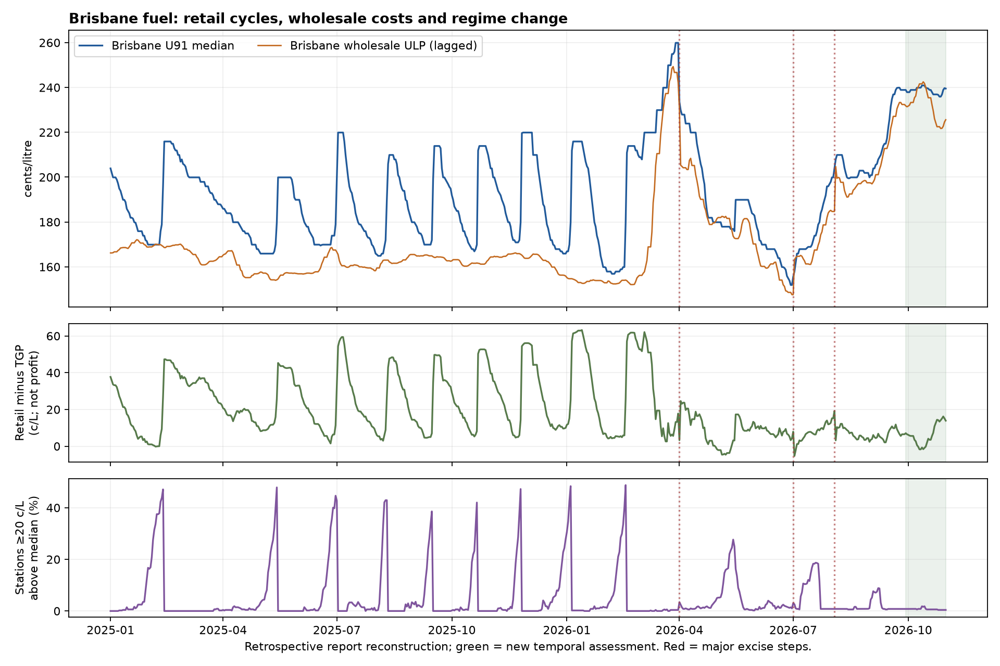

# Brisbane fuel forecasting: integrated research findings

4 November 2026, Australia/Brisbane.

**No model has earned a claim of dependable high accuracy at tomorrow, next-week,
fortnight or month horizons.** The research identifies useful historical structure
and implements tests, but does not justify promoting a fitted model into the
buying planner. Persistence remains the reference forecast.

## The question

Using only information available after Brisbane day t has closed, can we forecast
the Brisbane U91 daily station median at t+1, t+7, t+14 and t+28 more accurately
than carrying today's median forward? Do station behaviour and upstream costs
add information, and can we distinguish predictive relationships from causation?

The quantitative target is a **reconstructed, equally weighted station median**
in the repo's Brisbane rectangle. It is not an Australia-wide average, the price
at a particular servo or the cheapest executable purchase. The national evidence
review informs the mechanisms; empirical model conclusions here concern Brisbane.

## What was done

Three teams audited the data, tested models, and reviewed original Australian
research. The lead separately acquired upstream histories, tested publication-lag
and policy-window sensitivity, and reviewed the combined findings.

- Audited 150,308 official report events from 22 monthly files: 669 continuous
  reconstructed days, 1 January 2025–31 October 2026, across 509 stations.
- Downloaded official AIP Brisbane terminal-gate ULP prices, RBA AUD/USD, EIA Brent
  and US Gulf conventional gasoline histories using the configured source access.
- Reviewed eight original Australian studies, distinguishing full papers from
  restricted publisher previews, and verified excise announcement/effective dates.
- Built seven fixed forecasting candidates, daily walk-forward fits, horizon-specific
  scores, matured-error interval calibration and a separate large-rise diagnostic.
- Tested the mean target, a 434-station fixed cohort, and report-expiry sensitivity.
  Upstream correlation diagnostics also double publication delays and exclude
  windows around excise changes. An additional tax rule is disclosed as exploratory.
- Preserved the operational database, collector and application forecasting gates.
  Research outputs and repeatable scripts are separate from the running app.

The previously inspected April–August 2026 test is development evidence. The new
assessment uses origins after 28 September. Pre-cutoff origins whose target dates
cross that cutoff are embargoed from development selection. Training labels and
calibration errors must mature before each simulated forecast; preprocessing sees
only its training rows. October is retrospective assessment, not preregistration
or a newly saved prospective trial.

## What can actually be predicted so far

On the new period, carrying the origin median forward gives:

| Horizon | Eligible origins | Mean absolute error, c/L |
| --- | ---: | ---: |
| Tomorrow | 32 | 0.406 |
| Seven days | 26 | 1.792 |
| Fourteen days | 19 | 2.084 |
| Twenty-eight days | 5 | 1.480 |

These low errors describe a relatively quiet period. They do not establish
equivalent performance during a restoration or shock. The month-ahead origins
are only 29 September–3 October, with targets 27–31 October. Different horizons
use different dates; lower h28 than h14 error does not mean month-ahead forecasting
is easier. There are too few independent time blocks to support the declared
confidence comparison at any fresh horizon.

None of the six alternatives beats persistence on this primary later assessment;
damped trend ties it at h28. The model selected using development dates alone
also loses at each horizon:

| Horizon | Development-selected model | Later MAE | Persistence MAE |
| --- | --- | ---: | ---: |
| 1 | Panel analog | 0.539 | 0.406 |
| 7 | Panel ridge | 3.195 | 1.792 |
| 14 | Panel + context ridge | 13.394 | 2.084 |
| 28 | History ridge | 27.638 | 1.480 |

For example, panel ridge reduces development h7 MAE from 13.412 to 8.358 c/L
(37.7%), then is 78.3% worse than persistence in the later slice. The fixed
nonlinear boosting candidate also loses: its later h1/h7/h14/h28 MAEs are
0.811/5.143/13.225/9.637 c/L. More flexible fitting did not fix regime transfer.

The complete candidate and development-selection tables are in the
[model report](research-model-results-2026-11-04.md). In the fixed-cohort check,
every fitted alternative loses to persistence at h1 and h7. With the daily mean
target, damped trend improves h1 MAE by only 0.013 c/L (3%), with slightly worse
RMSE; it loses at h7. Development-selected mean and cohort models also lose on
the later period. None of that supports a generally accurate fitted upgrade.

The existing saved forward log is useful but sparse: only 43 completed scored
forecasts per model, spread over seven horizons and 11 issuing dates. There are
just three seven-day outcomes and no logged 14/28-day forecasts. Its date-only
records also lack exact issue times, code versions and input snapshots. It cannot
validate a high-confidence long-horizon model.

## The predictable structure is conditional

The archive shows large repeated retail cycles in 2025 and substantially tighter
retail/wholesale tracking later in 2026. This agrees with the
[ACCC's account of the change in Brisbane cycling](https://www.accc.gov.au/consumers/petrol-and-fuel/petrol-price-cycles-in-the-5-largest-cities).
A fixed weekday or fixed cycle-length rule is therefore a poor universal model.

Station dispersion provides a plausible early signal during a cycle: some
stations have restored while others remain cheap, before the median crosses the
market. Distribution features improve portions of development history, but
that does not establish transferable future skill. The fresh period contains
zero endpoint rises of at least 10 c/L at the evaluated horizons. A risk model's
lower false-alarm score there cannot validate its ability to detect a restoration.

The literature supports this direction without proving our model succeeds.
[Noel and Chu](https://www.noeleconomics.com/articles/NOEL_forecasting.pdf) studied
Australian cycle-based buying strategies; successful purchase timing is distinct
from predicting every future daily price.
[Clements and Otero](https://doi.org/10.1016/j.econlet.2024.112128) motivate spatial
station information, but their Perth results do not establish Brisbane accuracy.
This work is a local empirical extension of those ideas, not a demonstrated
improvement over their published results.

## International costs: mechanism, association and prediction

The [ACCC identifies Singapore refined-product prices and AUD/USD as major fuel
cost drivers](https://www.accc.gov.au/consumers/petrol-and-fuel/what-affects-fuel-prices).
No free long daily Singapore Mogas 95 feed was verified. US Gulf gasoline is
labelled as a different-market proxy throughout, never relabelled as Mogas.

Using available trailing seven-day changes, Gulf gasoline in AUD correlates with
following-week lagged available Brisbane TGP changes at +0.487 in 2025 and +0.441
in 2026. Its corresponding retail correlations are −0.048 and +0.207. The recent
retail relation is negative, and plausible publication delays change some signs.
That is consistent with a wholesale pathway plus changing retail dynamics. It
does not establish incremental accuracy after current TGP is already known.

These are descriptive, overlapping observations from current historical files,
not real-time vintages. Assumed AIP/RBA one-day and EIA four-day lags are not proof
of historical publication times. Neither a correlation nor a predictive gain
would identify causation. Shared shocks, FX, taxes, demand and competition remain
confounders; TGP is also a mediator. A causal estimate needs a separate defensible
instrument or policy/control design.

## Tax, uncertainty and data quality matter

Known excise changes are material controls. April's full cut was announced in
components; using the final rate at the earlier partial announcement would leak
information. A separate fixed seven-day announcement-aware tax baseline improves
development h7 MAE by about 1% and leaves fresh October forecasts identical to
persistence. It is a useful exploratory policy control, not a general solution.

Historical uncertainty bands are unstable across regimes. A quiet period can
produce near-total coverage simply because bands learned during volatile history
are very wide. Narrower reported errors alone do not validate useful intervals.
Long-horizon regressions can instead give poor coverage when their point forecasts
extrapolate incorrectly. Both coverage and width must be assessed.

The target itself has uncertainty. About 65.8% of station-days hold an earlier
report. Changing the expiry from 14 to seven days alters the median by more than
1 c/L on 74 days, with a maximum 37.5 c/L difference; 30-day expiry changes 32
days by more than 1 c/L. These are target-definition differences, not forecast
errors. Reported and locally collected medians differ by up to 8 c/L on available
overlap dates. Sub-cent errors against the reconstruction are not proof of
sub-cent accuracy against the actual market.

## Decision and next experimental step

Keep persistence as the reference and keep fitted models in research. A sensible
next hypothesis is a model separating station restoration diffusion from landed
cost pass-through, with an explicit fallback when the current regime is outside
its demonstrated conditions. That architecture still requires testing; it is
not declared the best model by this investigation.

The [forward protocol](research-forward-protocol-2026-11-04.md) specifies frozen
challengers, exact timestamps and input vintages, at least 180 completed origin
days plus outcome maturation, dependence-aware comparisons, and meaningful
event coverage. A practical initial promotion target is at least 10% MAE reduction
with robust evidence and useful intervals. If cycling never occurs in the trial,
the trial cannot validate restoration warnings.

Older 2023/2024 Queensland history is a feasible next development expansion; its
metadata and schema were checked, including the exceptional 2023 dataset slug.
It was not bulk-downloaded here and would not create fresh validation outcomes.
There is no basis yet to promise a particular percentage of future accuracy or a
causal coefficient for international prices.

## Evidence and verification

- [Research design](research-design-2026-11-04.md)
- [Data/provenance audit](research-data-audit-2026-11-04.md)
- [Full model results](research-model-results-2026-11-04.md)
- [Literature and verified tax calendar](research-literature-2026-11-04.md)
- [Upstream and tax diagnostics](research-context-results-2026-11-04.md)
- [Reproduction commands](../research/README.md)

Eight research timing/leakage/metric tests passed, and the research Python files compile.
The broad existing application suite was attempted but stalled at its original
area-route TestClient check and was interrupted; it is not claimed as passing.
No application code was changed. Small aggregate scoreboards and manifests are
retained in `research-assets/`; raw panels and individual predictions remain in
the ignored `.local/research-2026-11-04/` research cache.

Queensland data: © State of Queensland, CC BY 4.0. External sources and paper
access limitations are cited in the companion reports.
